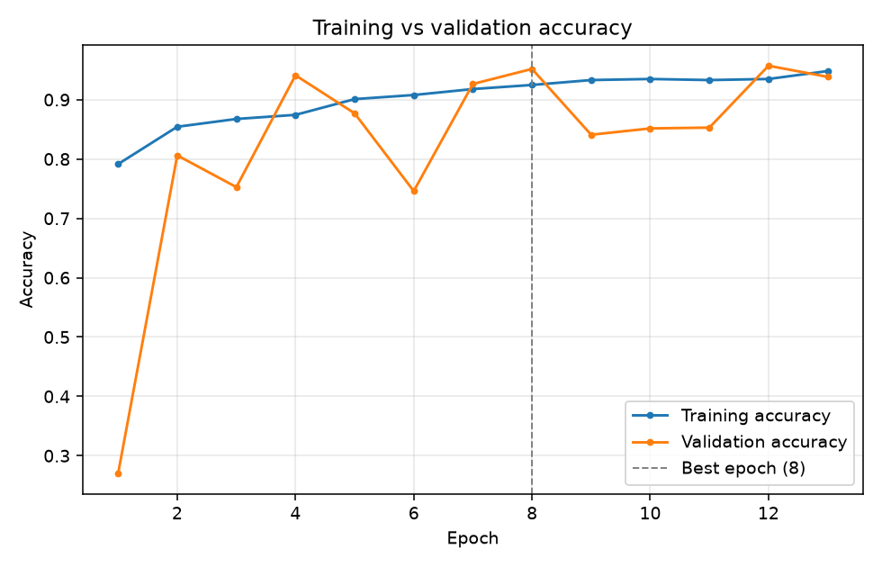
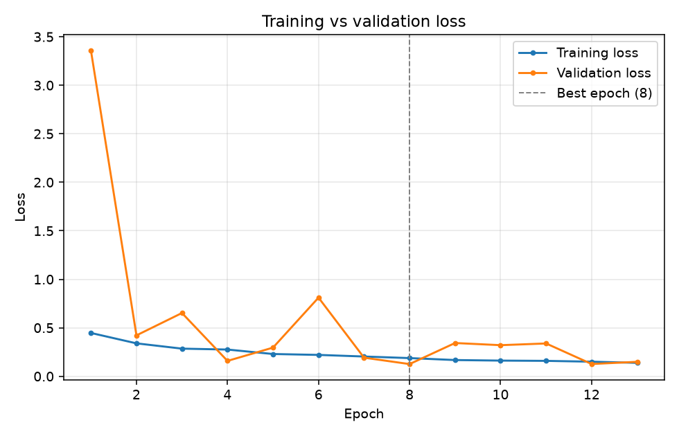
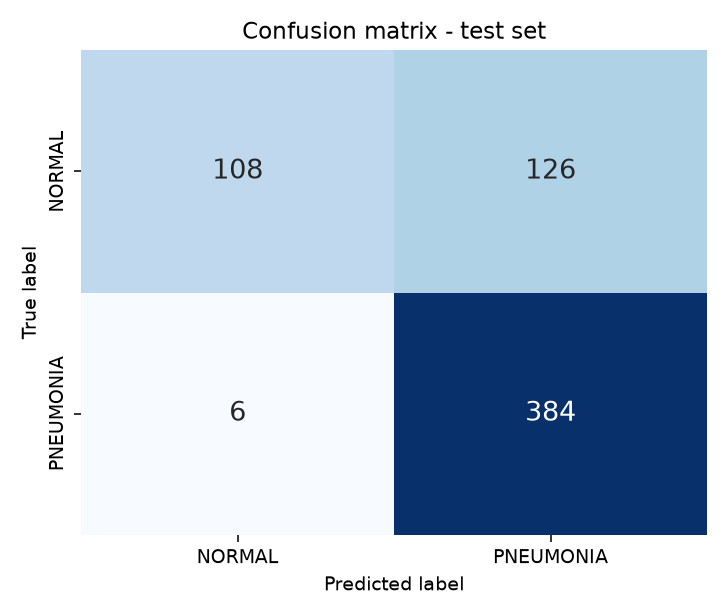
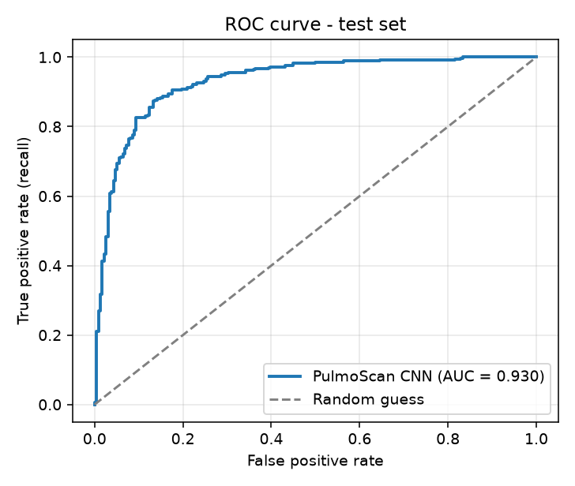
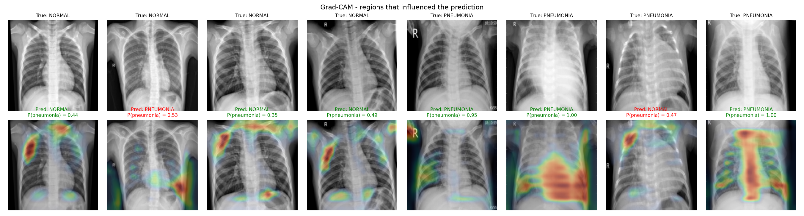

# PulmoScan AI

**Intelligent pneumonia detection from chest X-rays using a Convolutional Neural Network, with Grad-CAM explanations.**

Upload a chest X-ray and PulmoScan AI returns a *Normal* / *Pneumonia* classification, a confidence score, the probability of each class, and a heatmap showing which regions of the image influenced the model.

> **Educational prototype - not a medical device.** PulmoScan AI has not been clinically validated. Its output must never be used to diagnose, treat or rule out any condition, and it does not replace evaluation by a qualified healthcare professional.

**Live demo**

- App: https://pulmoscan-ai-topaz.vercel.app
- API: https://pulmoscan-api-8wdv.onrender.com/api/health (interactive docs at `/docs`)

The API runs on a free instance that sleeps after 15 minutes without traffic, so the first request can take about a minute; after that an analysis takes a few seconds.

---

## Contents

1. [Features](#features)
2. [Results](#results)
3. [Architecture](#architecture)
4. [Project structure](#project-structure)
5. [Quick start (run locally)](#quick-start-run-locally)
6. [Dataset and preprocessing](#dataset-and-preprocessing)
7. [Training and evaluating the model](#training-and-evaluating-the-model)
8. [The CNN](#the-cnn)
9. [Grad-CAM](#grad-cam)
10. [API reference](#api-reference)
11. [Deployment](#deployment)
12. [Limitations](#limitations)
13. [Viva preparation](#viva-preparation)

---

## Features

- **Real predictions** - a CNN trained from scratch in TensorFlow/Keras, served by FastAPI. Nothing in the UI is mocked.
- **Explainable** - a Grad-CAM heatmap for every prediction (overlay, heatmap-only and original views).
- **Measured metrics** - accuracy, precision, recall, F1, ROC-AUC and the confusion matrix are computed on a held-out test set by `ml/evaluate.py` and displayed as-is. No number in the UI is hard-coded.
- **Careful evaluation** - patient-grouped validation split (no patient appears in both training and validation), class weighting for the imbalanced data, early stopping.
- **Polished product UI** - React + Tailwind + Framer Motion: drag-and-drop upload, validation, loading states, skeleton loaders, toasts, interactive charts, fully responsive.
- **Deployed** - frontend as a static site (live on Vercel; Netlify configuration included), backend as a Docker container on Render.

## Results

Measured on the **624-image official test set**, which the model never saw during training or model selection (decision threshold 0.5). Produced by `ml/evaluate.py`; the same numbers are served to the Model Insights page from `backend/models/metrics.json`.

| Metric | Value |
| --- | --- |
| **Test accuracy** | **78.8%** |
| ROC-AUC | 0.930 |
| Pneumonia - precision / recall / F1 | 75.3% / 98.5% / 85.3% |
| Normal - precision / recall / F1 | 94.7% / 46.2% / 62.1% |
| Macro-average F1 | 73.7% |
| Validation accuracy (clean re-evaluation) | 95.2% (AUC 0.988) |

Confusion matrix (test set):

| | Predicted Normal | Predicted Pneumonia |
| --- | --- | --- |
| **Actual Normal** (234) | 108 | 126 |
| **Actual Pneumonia** (390) | 6 | 384 |

**How to read this honestly.** The model is very sensitive - it catches 384 of 390 pneumonia X-rays (98.5% recall) - but it is not specific: 126 of 234 normal X-rays are wrongly flagged as pneumonia. Validation accuracy (95.2%) is much higher than test accuracy (78.8%). This gap is a well-known property of this dataset: the official test images differ in distribution from the training pool, and small CNNs trained from scratch tend to over-predict pneumonia on them. The ROC-AUC of 0.930 shows the model ranks cases well, so the weakness is mainly where the 0.5 threshold falls on the test distribution. The threshold was deliberately **not** tuned on the test set, because that would make the reported number meaningless.

An earlier training run (BatchNorm momentum 0.99) was discarded because its validation curve was unstable; it scored 72.9% on the test set. The numbers above are from the second and final run. See [Limitations](#limitations) for how to improve on this.

Graphs generated by the pipeline (in `ml/outputs/`):

| Accuracy | Loss |
| --- | --- |
|  |  |

| Confusion matrix | ROC curve |
| --- | --- |
|  |  |



## Architecture

```
                     HTTPS (JSON + multipart upload)
 ┌──────────────────────────┐                 ┌─────────────────────────────────┐
 │  Frontend  (Netlify)     │  POST /api/predict  │  Backend  (Docker container)    │
 │  React + Vite + Tailwind │ ───────────────▶ │  FastAPI + TensorFlow/Keras     │
 │                          │                 │                                 │
 │  Landing · Analysis      │ ◀─────────────── │  validate → preprocess → CNN    │
 │  Model Insights · About  │  prediction,    │  → Grad-CAM → JSON response     │
 └──────────────────────────┘  probabilities, └────────────────┬────────────────┘
                               heatmap (PNG)                  │ loads at startup
                                                              ▼
 ┌───────────────────────────────────────────┐      backend/models/
 │  ML pipeline  (offline, run once)         │      ├── pulmoscan_cnn.keras
 │  preprocess.py → train.py → evaluate.py   │ ───▶ ├── metrics.json
 │  → gradcam.py                             │      └── history.json
 └───────────────────────────────────────────┘
```

**Why two hosts?** Netlify serves static files (HTML/JS/CSS) from a CDN. It cannot run a long-lived Python process with TensorFlow loaded in memory. So the React app is deployed on Netlify and the FastAPI model server is deployed separately as a container; the browser talks to it over HTTPS, and CORS on the backend allows only the Netlify origin.

**Request flow for one prediction**

1. The browser validates the file (type, size) and sends it as `multipart/form-data` to `POST /api/predict`.
2. The backend validates it again (size limit, really a JPEG/PNG, minimum dimensions).
3. `utils/preprocessing.py` converts it to 160 × 160 grayscale - the *same function* used to build the training data.
4. The CNN outputs P(pneumonia); `utils/gradcam.py` computes the heatmap for the predicted class.
5. The API returns JSON: label, confidence, both probabilities, heatmap images (base64 PNG), warnings and timing.

## Project structure

```
pulmoscan-ai/
├── frontend/                  React single-page app (deployed to Netlify)
│   ├── src/
│   │   ├── components/        Navbar, Footer, UploadZone, ResultPanel, Toast, charts…
│   │   ├── pages/             Landing, Analyze, Insights, About, NotFound
│   │   ├── services/api.js    the only file that talks to the backend
│   │   ├── hooks/ utils/
│   │   └── App.jsx            routes + page transitions
│   ├── public/samples/        four test-set X-rays for the "try a sample" feature
│   └── package.json
│
├── backend/                   FastAPI model server (deployed as a container)
│   ├── main.py                app, CORS, router registration
│   ├── app/                   config.py (env vars), schemas.py, state.py (model loading)
│   ├── routes/                predict.py, insights.py, health.py
│   ├── utils/                 preprocessing.py, gradcam.py, validation.py
│   ├── models/                pulmoscan_cnn.keras, metrics.json, history.json
│   ├── Dockerfile
│   └── requirements.txt
│
├── ml/                        offline training pipeline
│   ├── config.py              paths + hyper-parameters
│   ├── preprocess.py          download, patient-grouped split, resize, cache
│   ├── train.py               model definition + training loop
│   ├── evaluate.py            test metrics, graphs, metrics.json
│   ├── gradcam.py             Grad-CAM figures for the report
│   └── outputs/               generated PNG graphs
│
├── docs/VIVA.md               50 viva / interview questions with answers
├── netlify.toml               Netlify build + SPA redirect configuration
├── render.yaml                optional Render.com blueprint for the backend
└── README.md
```

## Quick start (run locally)

Requirements: **Python 3.10 - 3.13** and **Node.js 20+**. The trained model is already in `backend/models/`, so you can run the app without retraining.

**1. Backend** (terminal 1)

```bash
cd backend
python -m venv .venv
# Windows:  .venv\Scripts\activate        macOS/Linux:  source .venv/bin/activate
pip install -r requirements.txt
uvicorn main:app --reload --port 8000
```

Check http://localhost:8000/api/health and the interactive docs at http://localhost:8000/docs.

**2. Frontend** (terminal 2)

```bash
cd frontend
npm install
npm run dev
```

Open http://localhost:5173. In development the Vite dev server proxies `/api/*` to the backend on port 8000 (see `frontend/vite.config.js`), so no environment variable is needed.

## Dataset and preprocessing

**Dataset:** *Chest X-Ray Images (Pneumonia)* - Kermany, Zhang & Goldbaum, 2018. 5,856 paediatric chest X-rays (patients aged 1-5, Guangzhou Women and Children's Medical Center), labelled by physicians. Licence: CC BY 4.0.

- Mendeley Data (used here, no account needed): https://data.mendeley.com/datasets/rscbjbr9sj/2
- Kaggle mirror: https://www.kaggle.com/datasets/paultimothymooney/chest-xray-pneumonia

**Get the data and preprocess it** (from the project root, with the backend virtual environment active):

```bash
pip install -r ml/requirements.txt
python ml/preprocess.py --download
```

This downloads `ChestXRay2017.zip` (1.2 GB) into `data/`, extracts it and writes cached arrays to `data/processed/`. If you downloaded the zip yourself (Mendeley or Kaggle), put it in `data/` and run `python ml/preprocess.py` without `--download`.

**What preprocessing does**

| Step | Why |
| --- | --- |
| Grayscale, resize to 160 × 160 | X-rays carry no colour; a fixed small size makes training feasible on a CPU |
| Patient-grouped, stratified 85/15 train/validation split | The original validation folder has only 16 images. Grouping by the patient ID in the filename prevents the same patient appearing on both sides (data leakage) |
| Official test folder left untouched | An honest final score needs data that never influenced any decision |
| Pixel scaling 0-255 → 0-1 | Done by a `Rescaling` layer *inside* the model so it cannot be forgotten at inference |

| Split | Normal | Pneumonia | Total |
| --- | --- | --- | --- |
| Training | 1,156 | 3,328 | 4,484 |
| Validation | 193 | 555 | 748 |
| Test | 234 | 390 | 624 |

## Training and evaluating the model

```bash
python ml/train.py       # trains, saves backend/models/pulmoscan_cnn.keras + history.json
python ml/evaluate.py    # test metrics + graphs, writes backend/models/metrics.json
python ml/gradcam.py     # Grad-CAM sample grid -> ml/outputs/gradcam_samples.png
```

Restart the backend afterwards so it loads the new model and metrics. All hyper-parameters are in `ml/config.py`.

| Setting | Value |
| --- | --- |
| Optimizer / loss | Adam (lr 1e-3) / binary cross-entropy |
| Batch size / max epochs | 32 / 25 |
| Early stopping | on validation loss, patience 5, best weights restored |
| LR schedule | `ReduceLROnPlateau` (×0.5 after 3 stalled epochs) |
| Class imbalance | balanced class weights |
| BatchNorm momentum | 0.9 (moving averages follow the data faster than the 0.99 default, which stabilised validation) |
| Augmentation | rotation ±10°, shift 8 %, zoom 10 %, brightness ±10 %, contrast ±15 % (no flips - anatomy is not symmetric) |

This run: stopped after 13 epochs (best epoch 8), 30 minutes on a laptop CPU (Intel i5-1235U, no GPU), TensorFlow 2.21.0. At the best epoch: training accuracy 92.5% (measured with augmentation and dropout active), validation accuracy 95.2%.

## The CNN

```
Input 160×160×1
 └─ Rescaling 1/255
 └─ Block 1: Conv 3×3 (16)  → BatchNorm → ReLU → MaxPool   → 80×80×16
 └─ Block 2: Conv 3×3 (32)  → BatchNorm → ReLU → MaxPool   → 40×40×32
 └─ Block 3: Conv 3×3 (64)  → BatchNorm → ReLU → MaxPool   → 20×20×64
 └─ Block 4: Conv 3×3 (128) → BatchNorm → ReLU → MaxPool   → 10×10×128
 └─ GlobalAveragePooling → Dropout 0.4 → Dense 64 (ReLU) → Dropout 0.3
 └─ Dense 1 (sigmoid)  =  P(pneumonia)
```

106,193 parameters (a 1.37 MB file). It is deliberately compact: it trains on a laptop CPU and runs comfortably on free hosting. Design choices and the reasons for them are explained in [docs/VIVA.md](docs/VIVA.md).

## Grad-CAM

Implemented in `backend/utils/gradcam.py` (used by both the API and `ml/gradcam.py`):

1. Forward pass, keeping the feature maps of the last conv block (20 × 20 × 128).
2. Gradient of the class score with respect to those maps (the score is `p` for Pneumonia and `1 - p` for Normal).
3. Average each gradient map → one importance weight per channel.
4. Weighted sum of the feature maps → ReLU → normalise to 0-1.
5. Upscale to the image size and blend over the X-ray with a colour map.

The heatmap shows what influenced the *model*, not where disease is.

## API reference

| Endpoint | Method | Description |
| --- | --- | --- |
| `/api/health` | GET | `{status, model_loaded, metrics_available}` |
| `/api/predict` | POST | Multipart field `file` (JPEG/PNG, ≤ 10 MB) → prediction JSON |
| `/api/model/insights` | GET | Contents of `metrics.json` (architecture, dataset, training history, test metrics) |
| `/docs` | GET | Swagger UI |

```bash
curl -F "file=@frontend/public/samples/pneumonia-1.jpg" http://localhost:8000/api/predict
```

```jsonc
{
  "prediction": "PNEUMONIA",
  "confidence": 0.97,
  "probabilities": { "NORMAL": 0.03, "PNEUMONIA": 0.97 },
  "threshold": 0.5,
  "gradcam": { "overlay": "data:image/png;base64,…", "heatmap": "data:image/png;base64,…", "layer": "block4_relu1", "target_class": "PNEUMONIA" },
  "image": { "filename": "pneumonia-1.jpg", "width": 800, "height": 720, "format": "JPEG" },
  "warnings": [],
  "inference_ms": 85.0,
  "disclaimer": "Educational prototype only. …"
}
```

(The values above only illustrate the shape of the response.)

## Deployment

Deploy the **backend first** (you need its URL for the frontend), then the frontend, then tell the backend the frontend's URL.

### Step 0 - push the project to GitHub

```bash
git init
git add .
git commit -m "PulmoScan AI"
git branch -M main
git remote add origin https://github.com/<your-username>/pulmoscan-ai.git
git push -u origin main
```

`data/`, `node_modules/` and virtual environments are excluded by `.gitignore`. The trained model (1.37 MB) is committed so the backend can be deployed without retraining.

### Step 1 - backend on Render

The API uses roughly 420 MB of RAM with the model loaded (measured locally). Render's free instance has 512 MB, so it is a tight fit: if the service is killed for running out of memory, change `plan` in `render.yaml` to an instance with 1 GB or more. Free instances also sleep after 15 minutes without traffic; the next request takes about a minute while the container restarts.

1. Sign up at https://render.com with your GitHub account.
2. **New → Blueprint** → pick this repository. Render reads `render.yaml` (Docker build from `backend/`, free plan, health check on `/api/health`).
3. When asked for `ALLOWED_ORIGINS`, enter your Netlify URL (you will know it after step 2; `http://localhost:5173` works as a placeholder until then).
4. Wait for the build (several minutes - TensorFlow is a large install). Your API URL looks like `https://pulmoscan-api-xxxx.onrender.com`. Open `/api/health` to confirm `"model_loaded": true`.

**Alternative: Hugging Face Spaces (Docker SDK).** Spaces give far more memory (16 GB), but as of November 2026 creating a Docker Space on the free hardware requires a paid PRO subscription. If you have one:

1. Create an account at https://huggingface.co and choose **New Space** → name `pulmoscan-api` → SDK **Docker** → **Blank** → Public → Create.
2. Push the contents of the `backend/` folder to the Space repository (the Space needs `Dockerfile` and `README.md` at its root - `backend/README.md` already contains the Space configuration):

   ```bash
   git clone https://huggingface.co/spaces/<your-hf-username>/pulmoscan-api hf-space
   cp -r backend/* hf-space/          # Windows PowerShell: Copy-Item backend\* hf-space\ -Recurse
   cd hf-space
   git add . && git commit -m "Deploy PulmoScan API" && git push
   ```

   When asked for a password, use a Hugging Face access token with *write* permission (Settings → Access Tokens).
3. Wait for the build (a few minutes). Your API URL is `https://<your-hf-username>-pulmoscan-api.hf.space`. Open `/api/health` to confirm `"model_loaded": true`.
4. In the Space: **Settings → Variables and secrets → New variable** `ALLOWED_ORIGINS` = your Netlify URL (you will know it after step 2; come back and set it then).

**Other hosts (Railway, Fly.io, Koyeb, Cloud Run).** Any host that builds a Dockerfile works: point it at `backend/`, set `ALLOWED_ORIGINS`, and give it at least 512 MB of RAM (1 GB is safer).

### Step 2 - frontend on Netlify

1. https://app.netlify.com → **Add new site → Import an existing project** → pick your GitHub repository.
2. Build settings are read from `netlify.toml` (base `frontend`, command `npm run build`, publish `dist`) - leave them as detected.
3. **Add environment variable** before deploying:
   `VITE_API_URL` = your backend URL, e.g. `https://pulmoscan-api-xxxx.onrender.com` (no trailing slash).
4. Deploy. Note your site URL, e.g. `https://pulmoscan-ai.netlify.app`.

`netlify.toml` also configures the SPA redirect (`/* → /index.html`), so refreshing `/analyze` or `/insights` works.

> `VITE_API_URL` is baked in at build time. If you change it, trigger a new deploy (Deploys → Trigger deploy).

**Alternative: Vercel.** The live demo is hosted on Vercel, because the Netlify account used for this project had run out of free deploy credits. Import the repository at https://vercel.com/new, set **Root Directory** to `frontend`, add the same `VITE_API_URL` environment variable and deploy. `frontend/vercel.json` provides the SPA rewrite that `netlify.toml` provides on Netlify.

### Step 3 - connect them (CORS)

The backend only answers browser requests from origins it knows. This project's own frontends are listed in `_DEFAULT_ORIGINS` in `backend/app/config.py`. To allow a different site, either add it to that list or set the `ALLOWED_ORIGINS` environment variable on the backend host to its exact origin, for example `https://pulmoscan-ai.netlify.app` (no trailing slash; several origins can be comma-separated). The variable adds to the built-in list. The service restarts automatically. Then open the Netlify site → **Analysis** → the status pill should say *Model server online*.

| Variable | Where | Example |
| --- | --- | --- |
| `VITE_API_URL` | Netlify (build) | `https://pulmoscan-api-xxxx.onrender.com` |
| `ALLOWED_ORIGINS` | Backend host | `https://pulmoscan-ai.netlify.app` |
| `ALLOWED_ORIGIN_REGEX` | Backend host (optional) | `https://.*--pulmoscan-ai\.netlify\.app` (Netlify deploy previews) |

**Troubleshooting**

| Symptom | Cause / fix |
| --- | --- |
| "The API URL is not configured" | `VITE_API_URL` missing in Netlify, or site not redeployed after adding it |
| "Cannot reach the analysis server" + CORS error in the browser console | `ALLOWED_ORIGINS` does not exactly match the site origin (check `https`, no trailing slash) |
| First request takes about a minute | Free instances sleep after inactivity; the first request wakes the container |
| Backend restarts or returns 502 right after deploying | Out of memory on a 512 MB instance; move to a 1 GB+ plan |
| 404 on page refresh | `netlify.toml` not at the repository root |

## Limitations

- **Not clinically validated**; never use it for medical decisions.
- Trained only on **paediatric** X-rays from **one hospital** - performance on adults or other equipment is unknown.
- Only two classes; it cannot recognise other conditions and cannot tell whether an image is a chest X-ray at all (a simple colour check only warns about obvious photos).
- Confidence scores are raw sigmoid outputs, not calibrated probabilities.
- Grad-CAM maps are coarse and show model attention, not pathology.
- Results come from a single training run on a single split; no cross-validation or confidence intervals.
- **Low specificity on the test set** (46.2% of normal X-rays are recognised as normal): the model leans towards predicting pneumonia. Expect false alarms on healthy X-rays.

Ideas for future work: retrain on a GPU (for example free Google Colab) at 224 × 224 with two convolutions per block - set `IMG_SIZE` in `backend/utils/preprocessing.py` and `CONVS_PER_BLOCK` in `ml/config.py`; transfer learning (DenseNet/EfficientNet), larger multi-hospital datasets (NIH ChestX-ray14, CheXpert), bacterial vs viral classification, probability calibration, an out-of-distribution check, external validation.

## Viva preparation

[docs/VIVA.md](docs/VIVA.md) contains 50 likely questions with concise answers, covering the data, CNN design, evaluation, Grad-CAM, the API, the frontend, deployment and ethics.

## Acknowledgements

- Kermany, D., Zhang, K., Goldbaum, M. (2018). *Labeled Optical Coherence Tomography (OCT) and Chest X-Ray Images for Classification.* Mendeley Data, v2. https://doi.org/10.17632/rscbjbr9sj.2
- Selvaraju et al. (2017). *Grad-CAM: Visual Explanations from Deep Networks via Gradient-based Localization.* ICCV.
